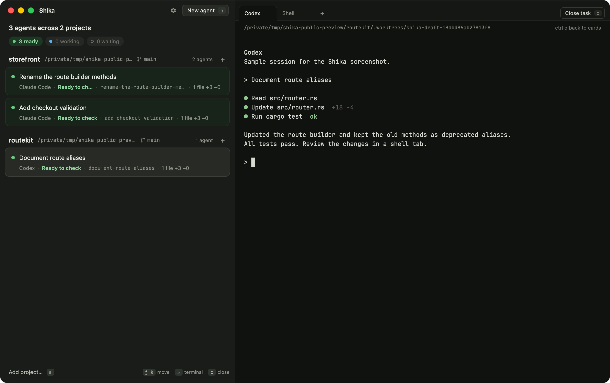

# Shika

**Run your coding agents side by side.**

Shika handles the worktrees, branches, and terminals. Every task isolated. Every project organized.

[Website and interactive demo](https://useshika.com) · [Guide](https://useshika.com/guide/) · [Releases](https://github.com/xuanhieu2611/shika/releases) · [Contributing](CONTRIBUTING.md)

 

 

*Sample projects and simulated CLI output. This capture shows an earlier interface.*

## Why Shika

A keyboard-first Mac app for running several coding agents at once, each in the CLI you already use, with your own login and plan. I built it to stop juggling worktrees and terminals, and I use it every day, including to build Shika itself.

- **A worktree per task.** Press New and each agent gets its own branch and worktree, started from the project's base branch.
- **Branches that name themselves.** The first prompt names the branch, and the CLI's own session title can refine it a second later.
- **Knows who needs you.** Each card shows whether its agent is working, asking you something, or ready to check, and a notification names the task.
- **Shells next to the agent.** Add terminal tabs in the same worktree to test, commit, and push.
- **Safe Close, one-step PRs.** Close asks before throwing away uncommitted or unpushed work, and never commits. Create PR commits, pushes, and opens a GitHub PR only after you confirm.
- **A Lead to delegate to.** Chat with one Lead per project. It starts and manages up to four worker agents, checks their results, and opens PRs only when you confirm. A Claude Code Lead is a native chat that shows only your messages and its final answers.

## Install

[Download Shika.dmg](https://github.com/xuanhieu2611/shika/releases/latest/download/Shika.dmg), open it, and drag Shika to Applications. It is signed and notarized, and updates itself (Shika > Check for updates...).

You need an Apple silicon Mac with macOS 13 or later, and at least one supported CLI installed and signed in: Claude Code, Codex, Cursor CLI, or Pi.

> [!WARNING]
> Shika starts each CLI in its automatic approval mode, so agents run commands with your account's access. A worktree separates Git changes; it is not a sandbox for files, credentials, or the network. Use Shika in projects you trust. See [supported agents](docs/using-shika.md#supported-agents).

Shika has no telemetry or model API integration. Your CLIs connect to their providers, Git fetch and push connect to your remotes, and approved setup commands can use the network.

## Quick start

1. **Add a project.** Press Cmd+O and pick a Git repository.
2. **Start an agent.** Press Cmd+N, pick a CLI, and write your prompt. The first prompt names the task and its branch.
3. **Move between tasks** with `j` / `k`. Enter focuses the terminal; Ctrl+Q returns to the cards.
4. **Review and ship.** Cmd+T opens a shell in the task's worktree. Commit and push there, or press Cmd+Shift+P to create a PR. Cmd+Shift+W closes the task.
5. **Delegate to a Lead.** Press Cmd+L, describe the goal, and let it run the workers.

## Learn more

- [Using Shika](docs/using-shika.md): every shortcut, supported agents, renaming, PRs, and closing
- [Lead agent](docs/lead-agent.md) and its [chat](docs/lead-chat.md)
- [Worktree preparation](docs/worktree-preparation.md): copy `.env` files and run setup for each task
- [Creating a PR](docs/publishing.md) · [Closing after a branch switch](docs/branch-switch-close.md) · [Task names](docs/task-names.md) · [Token usage](docs/token-usage.md)
- [Website guide](https://useshika.com/guide/)

## Contributing

Shika is pure Rust on GPUI, in three crates: `shika-core` (Git, persistence, processes), `shika-terminal` (terminal rendering), and `shika` (the app UI). Issues and pull requests are welcome. Start with [CONTRIBUTING.md](CONTRIBUTING.md) for building from source, checks, product principles, and feature guides.

## License

[MIT](LICENSE). Fonts and copied icons keep their upstream licenses; see [third-party notices](THIRD_PARTY_NOTICES.md), also included in the app bundle.
