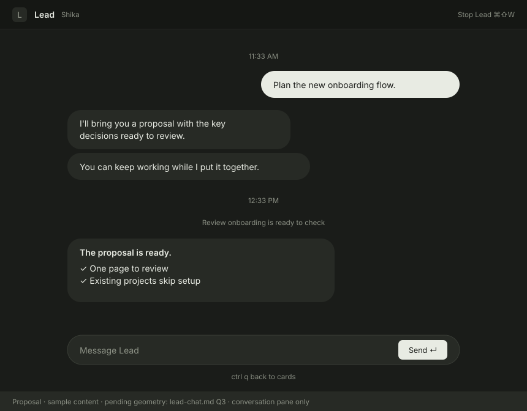
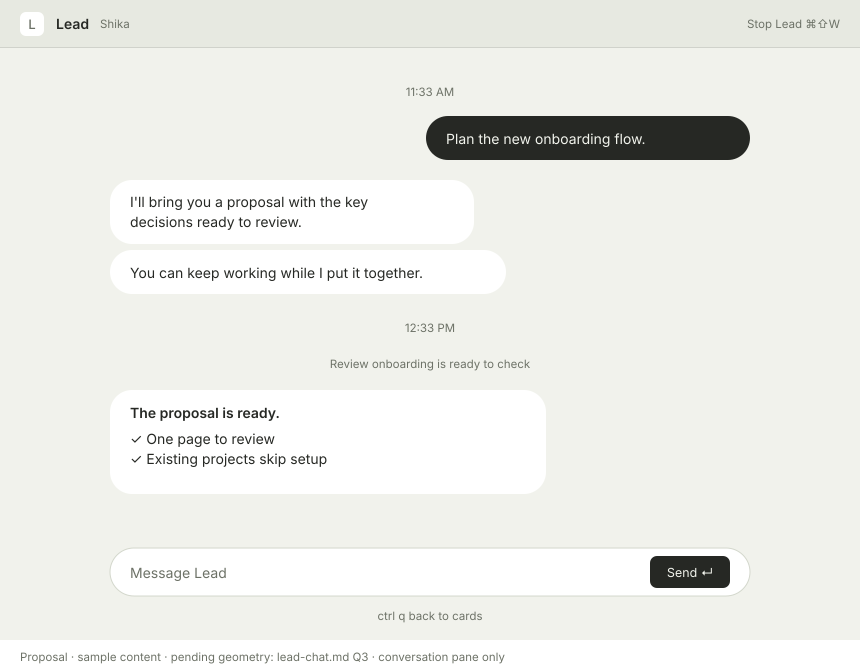

# Shika design system

Shika is a keyboard-first Mac app for running a few coding agents at once. It is named for Shikamaru: the one who keeps track of everyone on the field while you give directions. Shika creates a git worktree per task, starts the CLI the user already uses (Claude Code, Codex, Cursor CLI, Pi) in a real PTY, and notifies them when an agent needs attention or finishes a turn. Closing the task removes its worktree after the safe-close checks. A push keeps the task open. Kiro is planned.

The user is a developer who does not watch agents work. They start a task, go to the browser, and come back on a notification. The UI is built around that: a wide column for tracking agents, a smaller terminal for the moments they need to read or answer, and, only when asked for, a read-only Changes panel for a quick look at what a turn changed.

**Sources**
- `design/Shika v3.dc.html`: the archived visual reference. Its original runtime and styles are not included beside it, so it is not a standalone runnable page. The browser demo lives in `site/demo/` and uses sample data; the native app and this written spec define current behavior.
- Logo artwork: `design/assets/shika-logo.png`.
- The values that ship are in the app, listed below. This folder is not imported.

---

## Index

`design/` is the written spec and the picture. The CSS token files, JSX components, ui kit, guidelines, loader, and skill are not here. The app is the copy that runs.

- `design/DESIGN.md`: color, type, spacing, layout, focus, motion, copy, and icons.
- `design/Shika v3.dc.html`: the visual reference. It still names the old CSS variables. Those names are the vocabulary in this file. They are not a stylesheet the app loads.
- `design/assets/`: `shika-logo.png` (transparent mark) and `shika-app-icon.png` (1024 tile). The running app uses `assets/macos/Shika.icns` and `assets/macos/shika-app-icon-256.png`. JetBrains Mono is `assets/fonts/`.

**Chrome.** `crates/shika/src/main.rs` draws the window: the top row, project headers, cards, footer, terminal header, the CLI picker, the dialogs, settings, the toast, the update notice, and the shared pieces (`kbd`, `hint`, `secondary_button`, `primary_button`, `segment`, `dialog_shell`). Radii, spacing, and type sizes are the values there. Every chrome color is a field of `Chrome` in `crates/shika/src/appearance.rs`, so a token changes in one place. Shika Light and Shika Dark set each field by hand, with solid, glass, light, and dark values; every other theme derives them (see Themes under Color). Status words are `Status::label` and `Status::chip` in `crates/shika/src/model.rs`.

**Themes.** `crates/shika-terminal/src/catalog.rs` lists every theme a user can pick: an id saved in `settings.json`, the name shown in Settings, light or dark, its terminal `Palette`, and optional UI surfaces (`ThemeUi`: mantle, surface, muted) from the theme's own published palette. Settings picks one light and one dark theme and a mode; `appearance::resolve_theme` turns the saved ids into catalog themes.

**Terminal.** `Palette::shika_dark` and `Palette::shika_light` in `crates/shika-terminal/src/theme.rs` are the Shika terminal colors, including each ANSI 16. Other themes bring their own palette in the catalog. `appearance::terminal_palette` gives the terminal the column's background (`--term-bg`), so Shika Dark is `#1A1C19` (glass `#181A17`) with foreground and cursor `#D5D9CF` and selection that color at 18%, and Shika Light is `#F1F2EC` (glass `#F6F8F2`) with foreground and cursor `#262824` and selection that color at 14%. Font, size, line height, and padding are `TerminalConfig` in `crates/shika-terminal/src/view.rs`.

**Publishing.** Create PR is a bordered button in the terminal metadata row, styled like Close task (1px term-seg-active border, radius 6, hover term-hover, 12 text, the same padding) with a key cap showing the Create PR chord, the fixed ⌘⇧P (it is not one of the rebindable Settings > Keyboard shortcuts). Its tooltip is "Commit, push, create PR" plus that chord ("Commit, push, create PR ⌘⇧P" by default). The Agent menu exposes the same action. Its 400px confirmation dialog reuses dialog tokens, 360px mono text fields, a multiline description, selectable branch list rows, and scrollable file names capped at the existing base-list height. Title "Create PR?". The fact line names the repository and source branch. An empty file list reads "Nothing new to commit". Labels are "Commit and PR title", "PR description", and "PR target". An empty description leaves the body to the commit messages (`gh --fill`). Cancel `esc`, and primary "Commit, push, create PR" `↵` ("Publishing..." while busy; `⌘↵` while the description is focused). Tab switches fields. Enter confirms from the title or target. Enter in the description inserts a line, and Cmd+Enter confirms from there. Escape cancels. Missing recorded targets ask for explicit selection. Errors stay in the dialog; completion restores focus and opens the PR URL. No new color, size, or animation tokens. See `docs/publishing.md`.

**Changes.** The read-only Changes panel right of the terminal is specified under Changes panel below, its diff colors under Color. Behavior, refresh, and caps are in `docs/changes-panel.md`.

**Glass.** Opacity, blur, and whether frost covers the sidebar alone or the sidebar and terminal: `crates/shika/src/appearance.rs`, saved by `crates/shika-core/src/settings.rs`. The values are under Glass below. There is no `tokens/glass.css`.

---

## Content fundamentals

Shika talks like a terse colleague. It reports facts and names consequences. It does not cheer, apologize, or explain itself.

- **Sentence case everywhere.** Buttons, titles, statuses: "New agent", "Ready to check", "Delete worktree". The only all-caps text is "SHIKA" in the notification header, matching macOS.
- **Status words are fixed:** Ready to check, Working, Waiting, Asking you. They name the states and are not painted on the card. Asking you is a recognizable blocking permission/question dialog, not a semantic guess from prose. Never invent synonyms ("Needs input", "Done").
- **Address the user as "you", rarely.** "Asking you". Shika never says "I" or "we".
- **Buttons are verbs naming the outcome:** "Delete worktree", not "OK" or "Yes". Cancel is "Cancel".
- **Confirm dialogs ask a question about the specific task**, then list the facts: "Close “Fix flaky resize test”?" / "The worktree has 2 uncommitted files: src/cli.rs, src/layout.rs." / "This stops the session and force-removes .worktrees/fix-flaky-resize-test."
- **Branch-switch close** uses the existing close dialog shell and tokens: "Close “{task}” after branch switch?", recorded/current branch facts in mono, publication and branch-preservation facts, and an active-agent warning when applicable. Cancel `esc` and the primary Close task `↵` are the only choices. Unsafe recovery shows an error instead of offering destructive actions. Both local branches stay; no ownership transfer. See `docs/branch-switch-close.md`.
- **Toasts are past tense, one sentence:** "Pushed fix-flaky-resize-test. Card and worktree removed."
- **Errors state the cause plainly:** "kiro not found on PATH". No "Oops".
- **Use real developer nouns:** branch, worktree, PATH, push. Branch names and paths are always in mono.
- **Key hints are lowercase verbs:** move, new, terminal, shell, close.
- **No emoji. No exclamation marks. No marketing copy inside the app.**
- Card titles start with the user's prompt, then the CLI's own title, shortened; a manual task name takes priority. Before the prompt is sent the card reads "New Claude Code" (or whichever CLI), unless manually named. While the task is still on its `shika-draft-<id>` branch (not yet named), line two shows only the CLI mark (see Iconography), never the draft branch; the title stays "New Claude Code".

---

## Visual foundations

Names such as `--ink-1` and `--surface-app` are how this document talks about color, type, and space. The app implements them as GPUI values in the files in the Index. Do not add a CSS file beside them.

**Overall feel.** A quiet Mac app in the spirit of Obsidian and the Codex app: warm neutrals, system font, hairlines instead of boxes, and almost no color. The default themes are Shika Light (sage-tinted paper) and Shika Dark (warm charcoal), following the system appearance. Settings can pick another light and dark theme from the catalog, and can force light or dark. The agent column and the terminal share one background, split by the column's hairline. The only hues are the four status colors, so anything colored on screen means "look here". The one exception is the code surface of the Changes panel, where added and removed lines take the terminal palette's green and red, as a CLI would paint them in the terminal beside it.

**Color.**
- Neutrals carry a faint sage tint taken from the logo (hue ~120, very low chroma). Light: ink `#262824` on column `#F1F2EC`, raised `#FFFFFF`. Dark: ink `#E8EBE3` on column `#1A1C19`, raised `#272A25`.
- Brand tokens (`--brand-ink`, `--brand-sage`, `--brand-cream`, `--brand-mint`, `--brand-tile`) come from the logo and are for the logo, icon and wordmark only, never UI chrome.
- Status is the only color: amber = asking you, green = ready to check, blue = working, grey = waiting. Red is reserved for failed PR checks, and colors only the PR mark. The one exception is a ready card's diff counts (see Diff colors). Each has two tokens: `dot` and `text` (meets contrast on the column). Cards carry no status tint: a fill means selection.
- There is **no brand accent**. Selection and focus use ink (`--focus-ring`), not blue. Primary buttons are ink-filled.
- **Themes.** Shika Light and Shika Dark are hand-tuned: the values in this file. Every other catalog theme derives each `Chrome` field from its palette and `ui` (`derived_chrome` in `crates/shika/src/appearance.rs`), so it looks like that theme with Shika's layout and hierarchy:
  - Its background is the column and the terminal, solid and in glass. `ui.surface` is raised controls, dialogs, and the picker. Cards have no surface: the selected card is an ink wash. `ui.mantle` is the solid terminal header, key caps, and sunken tracks. Without `ui`, the surface is a step toward white (light) or the foreground (dark), and the mantle a step toward the frame.
  - `--ink-1` is the foreground. `--ink-3` is `ui.muted`, or the foreground 42% of the way to the background, pushed until it meets 4.5:1 on the column. `--ink-2` is halfway between them; `--ink-4` and `--ink-5` fade `--ink-3` 33% and 65% toward the background.
  - Lines, washes, and rings are the foreground at a low alpha, as on Shika's glass, so they work over glass.
  - Status: ready is ANSI green, asking ANSI yellow, working ANSI blue, waiting the `--ink-4` grey. The dot is the ANSI color. Text darkens it toward black (lightens toward white on a dark theme) until it meets 4.5:1 on the column, which keeps the hue.
  - The primary button is the foreground with background text. The toast is inverted the same way. Popups stay solid.
  - The terminal header follows the same rules as Shika's: a step (the mantle) when solid; in frost it keeps the terminal's color and the step is its alpha.
- **Diff colors.** Inside the Changes panel's rows (diff lines and the file header counts), and on a ready card's `+N` and `−N` (the file count stays ink-3); never elsewhere in chrome. The card uses the text color only, never a tint, and that text also meets 4.5:1 on the column. Added is the active terminal palette's ANSI green (ANSI 2), removed its ANSI red (ANSI 1). A tint is the terminal background mixed toward the hue, 8% on a light theme and 10% on a dark one, and it is opaque, like a CLI-colored cell in the terminal. The text is the ANSI color, darkened toward black (lightened toward white on a dark theme) until it meets 4.5:1 on its tint, which keeps the hue: the same rule as derived status text. Every theme derives them this way in `chrome_for`; Shika's results are: Light added tint `#E3E8DE` text `#3A7439`, removed `#ECE4DE` / `#AE4539`; Light glass added `#E7EEE3` / `#3B763A`, removed `#F1EAE3` / `#B2463A`; Dark added `#252D24` / `#8CC98A`, removed `#2E2521` / `#E0786B`; Dark glass added `#242C23` / `#8CC98A`, removed `#2C231F` / `#E0786B`.
- The terminal takes the theme's background and a soft ANSI 16 (`--ansi-*`). Shika Light's normal ANSI colors meet 4.5:1 on its background, and its bold text keeps its color instead of switching to the lighter bright set. The terminal header is a step darker than the terminal when solid (`#151714` dark, `#E7E9E1` light); in frost it keeps the terminal's color and the step is its alpha. Terminal-side lines and washes are translucent ink: white in dark, black in light.

**Type.**
- Two families. UI: the macOS system font (SF Pro) via `-apple-system`. Code, paths, branches, timers, key caps and the terminal: JetBrains Mono.
- Exact sizes, not a grid: 15 / 14 / 13.5 / 13 / 12.5 / 12 / 11.5 / 11 / 10.5. Weights 400, 500, 600 only.
- Timers use `tabular-nums` so they don't jitter.
- Anything a developer might copy (branch, path, command) is mono.

**Layout.**
- Agent column 30% of the window by default (420px in the 1400px window it opens in), terminal takes the rest. It is a share of the window, so it keeps its proportion when the window resizes. One terminal on screen, ever. The Changes panel, when open, sits right of the terminal (`[column][terminal][panel]`); it is a read-only diff, not a second terminal. The window opens at 1400x880 and stops at 960x600.
- The column's right edge resizes it: an invisible 8px strip centered on the hairline, with the resize cursor. On hover and through a drag a 2px ink-4 line shows in the strip. A drag sets the share; on screen the width stays 320 to 800, and the terminal keeps at least 420. Double-click restores 30%. A drag stops at 320 and never hides the column; only the toggle does.
- The column can hide (Cmd+B). Its toggle is a 24px icon button (radius 6, 15px glyph: a window with its left pane split off, drawn for Shika) right after the wordmark (gap 8), ink-3, ink-1 on hover, tooltip "Hide agent column ⌘B". Hidden, the terminal header keeps the same "Shika" wordmark and button after the traffic lights (at the same inset, centered in the 48px row), with the same ink and hover colors, tooltip "Show agent column ⌘B"; over the empty state the pair sits in the drag strip. With Leftover worktrees showing, a column below 420px drops the footer's key hints. On a card's second line the branch truncates before the diff stat.
- The 48px top row of both halves is the title bar; there is no separate title strip. Column half: the real traffic lights (x 18, centered), the wordmark "Shika" (13.5 semibold), and the column toggle beside it; nothing else, so the bar stays quiet. New agent lives on the Projects header and the gear in the footer. Terminal half: the terminal header, or a plain strip over the empty state. Empty space in both halves drags the window and a double-click zooms.
- No summary: the Leads section starts right under the top row. Status lives on the cards.
- Project list (padding 8 12 18, 20 between projects, 6 inside). Header (min height 24, padding 0 4 0 8, gap 10): name 15 semibold (truncates last; its tooltip is the path with `~`), the base branch New starts from (`dev`, or `main` when unset) in mono 12 ink-3 after a 12px git-branch glyph (gap 4), both turning ink-1 on hover and shows the tooltip "Base branch ⌘⇧B" (it is hidden while unresolved or when the configured branch is missing), then `+` (24px icon button, opens the picker for that project). The `+` shows only while that project's header is hovered or the selected card belongs to that project (its own cards, its Lead, or the Lead's workers; also when the project's header is the selection). Otherwise it is hidden, but its slot keeps its width so nothing moves. No path and no agent count on the row: the cards below are the count. A click on the base branch, or `⌘⇧B`, opens the Base branch dialog. A clicked header that left a terminal or Lead chat on screen (see Focus model) is drawn selected and is the project New, Lead, and Base branch aim at until the selection changes. Remove shows only while the header is hovered. A selected header gets the row-selected wash, radius 6. `j`/`k` moves through cards and skips headers. Every card is shown. The list scrolls when it does not fit.
- Footer (top line-2, padding 10 12 12): the gear (a 24px column icon button, tooltip "Settings ⌘,"), "Leftover worktrees (N)" when there are leftovers (12.5 ink-2, hover wash, radius 6), and on the right `⌘] ⌘[` move, `⌘⇧W` close (11 ink-3). The hints stay on that one line. There is no Add project button here; it is on the Projects header, and `⌘O` adds one.
- Terminal header (48px, term-header fill, bottom term-line): connected, task-scoped terminal tabs, not a segmented control. Tabs stand on the bottom line of the row and reach 5 under its top, 42 high, radius 7 on the top corners only, padding 0 12, 12px, their label lifted 4 off the tab's middle so it sits on the bar's middle line (y 24) with the traffic lights and the wordmark, min 88 and max 180 wide with the label truncated, no gap between them, starting 8px from the left so the label lines up with the terminal text. The active tab is filled with term-tab, has a 1px term-line outline on its top and sides, and term-white text; at the bottom its sides flare outward in concave curves of radius 7 that run into the bottom line, which breaks under it, so the tab opens into the terminal. The flares are painted over the bottom corners of the neighbors, so labels do not move when the active tab changes; a neighbor's bottom line stops where a flare meets it, and the strip keeps 7px after the last tab for its flare. term-tab is the terminal background adjusted so that, painted over the translucent header, it gives exactly the terminal's pixels. Inactive tabs are term-dim text with no fill; hover gives term-fg text and fills the tab's own shape with the term-hover wash: the same top, sides, and flares, standing on the bottom line instead of breaking it, with no outline. Beside the active tab, the hover's bottom corner on that side rounds inward (radius 7) and fits inside the active tab's flare. Only the pinned CLI tab exists initially. Shell tabs are added on request and numbered monotonically (Shell, Shell 2). Each shell has a 16px `×` (radius 4, hover term-hover and term-white, tooltip "Close shell tab (stops its processes) ⌘W"), always shown on the active tab and on hover otherwise, in a fixed slot so the label does not move. The CLI tab has no `×`. `+` (24px, radius 6, 15px glyph, tooltip "New shell tab ⌘T") follows the last tab; when tabs overflow, the strip scrolls and `+` stays at its right edge. Close task `⌘⇧W` (1px term-seg-active border, radius 6, hover term-hover) stays at the right. `+`, Close task, and the Changes toggle are centered on the bar's middle line too, so every label and control in the title bar shares one line. The bottom line is drawn by each piece of the row, never by the header, since a translucent tab cannot hide a line under it. Selection reveals the tab without pinning manual scrolling. A metadata row below the header (padding 8 20 2, gap 12) shares the terminal background, as part of the active tab's page. At the left, in place of the worktree path: the project name (system 12, term-fg), a 12px git-branch glyph (`BRANCH_ICON`, the one project headers use, term-dim), gap 6, then the branch in mono 11.5 term-dim, truncating at the end; the project name does not truncate before the branch does. Its tooltip is the full worktree path with `~` for home (a draft task shows its `shika-draft-<id>` branch here). Then Create PR, in the same position as before (see Publishing), and the focus hint, 11.5 term-faint-ui, "↵ type here" or "ctrl q back to cards"; "setup is non-interactive" for a card still being created, "↵ retry setup" for a failed one with the cards focused.
- Empty terminal: the app icon 64px, "No agent selected" 13 term-faint-ui, and `j` select, `⌘N` new agent. The toast sits centered over the terminal side, 22 from the bottom. A selected resting Lead uses the same layout with the message "{project} Lead is not running" and one key cap, `↵` resume; the whole area is a click target (pointer cursor) that resumes it, with no hover change and no new token.
- Projects stay visible even with no agents: the header alone, with nothing under it. Its `+` or `⌘N` starts one. In the Projects section, groups with cards precede empty headers, preserving saved project order within each group. Only cards shown in this section count, not Leads or their workers shown above. A last card's exit finishes before its project becomes empty. This is display order only; the saved repository list, picker, and Settings order stay unchanged.
- Cards inside a project are sorted by attention: asking, ready, working, waiting. A project lists only the author's own cards, never a Lead or a worker of a live Lead.
- Sections. The list always opens with a Leads section, then a Projects section, 20 apart. Each starts with a header (min height 24, padding 0 4 0 8 like a project header, gap 2): the label "Leads" or "Projects" in 12 medium ink-3, sentence case, aligned with a project header's text, then its actions at the right as column icon buttons (24px, radius 6, ink-3, ink-1 on the hover wash, a tooltip with the key). Leads has `+` ("New Lead ⌘L"). Projects has the folder-plus glyph ("Add project ⌘O") and `+` ("New agent ⌘N"); both `+` buttons line up with each project header's `+`. The actions always show. With no Lead, the Leads section is its header alone, like an empty project. Under the Leads header, one Lead per project in project order, live or resting, and directly under each live Lead the workers it started, sorted by attention and indented 16 so they read as belonging to it. A resting Lead has no workers under it. The Projects header sits 6 above the first project header. When a Lead is stopped, its workers become ordinary cards of their projects. `j`/`k` walks the Leads section first (Lead, then its workers; a resting Lead is one stop), then the projects.
- The Changes panel's layout, rows, and empty states are under Changes panel below.

**Cards.** Radius 10, padding 12/14/11, gap 6. Line one: the task in 14 semibold (line 20, ink-1; ink-2 while it still reads "New <CLI>", ink-1 on the selected card), then, gap 10, the elapsed turn time in mono 11.5 in the working text color, shown only while Working (`42s`, `51m`, `1h 3m`), including blocked time and never reset by drafts, terminal interactions, or status flicker, and the status signal at the right end, a 14px slot so signals line up down the column. Working: a 5x5 field of 2px pixels in the working dot color, gap 1, 14px square, 3px from the top of the line, that twinkle about eight at a time (see Motion); every size and offset is a whole point. Ready: an 8px ready dot until the result is seen. Asking: an 8px amber dot, including after the blocker was seen. Waiting: an 8px solid dot in the waiting ring grey. A seen Ready card shows nothing there. There is no dot on the left; the eye reads to the right. A Ready result is seen when its terminal has focus, or when the card stays selected for one second while the window is active, so `j` passing over it does not count. Each turn that ends brings the dot back. Line two (no indent, 12px ink-4, gap 6, `·` in ink-5; ink-3 and ink-4 on the selected card, so it stays readable on the wash) sits back so the task reads first: the CLI mark (14px, in the line's ink, tooltip the CLI name; see Iconography) · branch (mono 11.5, truncates before the diff stat) · the diff stat while Ready, like `2 files +64 −3` with a real minus, the file count in ink-3 and the counts in the diff added and removed text colors · after Create PR, the PR mark: `#42` in mono 11.5, gap 4, then a 7px ink-4 ring while checks run, `✓` when they pass, or `✗` when one fails, the whole mark in the failed text color and medium weight then; ink-3 otherwise, and the number alone when the repository reports no checks. The mark never truncates, has no hover color, and a click opens the PR without focusing the terminal; its tooltip is "Checks running", "Checks passed", "Checks failed", or "Open PR". The diff stat is text on the card: no pointer, hover, or tooltip. A click on it is a card click, so it selects the card and focuses its terminal. The panel stays as it is. Status on a card is the signal, the timer, the diff stat, and the PR mark. A failed mark does not change the card order. While setup is running or has failed, the stage or "Setup failed" sits between the CLI mark and the branch in the status text color (600 Ready/Asking, 500 Working, 400 Waiting). A long setup stage gives way; "Setup failed" stays whole. The status words are not painted on the card. The selected card shows key hints on the right while the cards have focus: Ready `↵ read`, Asking `↵ answer`, Working `↵ watch`, Waiting `↵ write prompt`. A card still being created reads `↵ view setup` and `⌘⇧W cancel`; a failed-setup card reads `↵ retry` and `⌘⇧W close`; Enter retries, as does its Retry setup button. Key caps everywhere: mono 10.5, sunken fill, ink-2, radius 4, padding 1 5 (0 5 inside a card). No agent output on cards. At rest a card is bare text on the column: no fill and no border. Selected: the card-selected wash, an ink wash stronger than hover (10% light, 12% light glass, 18% dark, 20% dark glass; the theme's foreground at 10% light and 18% dark in derived themes). Light ink on a dark column reads weaker than dark ink on a light one, so dark takes the larger step, with no outline or shadow, so glass shows through it. The same wash whether the cards or the terminal have focus; the key hints are what show the cards have focus.

**Checkout session.** Cmd+Shift+N or Agent > New Agent in Checkout reuses the CLI picker, titled "In checkout", with project and current branch in the footer; Tab changes project and Escape restores focus. Settings > Keyboard can replace or clear this chord. The existing checkout card is selected and focused instead of opening another picker. No column/header action is added. During its short launch the existing progress row says "Starting agent...", with Cancel start and the hint "starting agent", never worktree setup. The card stays first in its project, ahead of attention order, with the ordinary title, signal, timer, and diff stat. Line two uses the CLI mark, a separator, then `CHECKOUT_ICON` (12px, line-two ink, a Shika-drawn folder with a terminal prompt), then the checked-out branch in mono 11.5, truncating before the stat. The icon's tooltip is "Runs in your checkout, no worktree". Detached HEAD shows the short commit. Branch reads happen off-thread on selection and Ready, never by polling. The terminal metadata row shows the repository path in mono and the current branch, read-only; there is no Create PR button and its action is inert. Diff stat and Changes compare against HEAD, counting uncommitted work only. Shell tabs, Switch agent, rename, status and notifications reuse the ordinary flows. Idle Close stops its terminals immediately without consulting git. Active or blocked Close reuses the 400px dialog shell: "Stop the agent?", the fact "The agent is still active. This stops its terminals. Your checkout and files stay unchanged.", Cancel `esc`, and primary Stop agent `⌘↵`. Only exact Cmd+Enter confirms, with the existing 300ms key grace. No Discard, Push, branch deletion, or worktree removal.

**Lead card and workers.** A project's Lead is an ordinary card (same signal, timer, selection, and hints) in the Leads section, with four differences. Its task line names the project, in ink-1, with no "Lead" word appended (the terminal header and notifications still call the task "Lead"). On the left it has the antler mark tile: 30px, radius 8, raised fill (raised_hover on the selected card), the mark (`ANTLERS_ICON`, see Iconography) 18px in ink-2, spanning both lines, gap 10 to the text, top aligned 2px below the card's top padding; the status signal, timer, and hints stay at the right as on any card. Worker cards under a Lead keep their 16px indent and have no tile. Line two (12, in the card's line-two inks: ink-4, ink-3 selected, truncating with an ellipsis; text in the system font, not mono) is, for a live Lead: while Working, the current activity step text, the same string as the chat's current step ("Opening Create PR for Fix flaky resize test..."); otherwise the first line of the Lead's latest final reply as plain text (markdown stripped, whitespace collapsed). With no reply yet, or for a Lead with no chat (Codex, Cursor CLI, and Pi Leads still run in a terminal and have no reply text), it reads the CLI mark, `·`, then "Lead" in ink-2 medium, as before. Terminal Leads still show the current step while Working, since steps come from the control socket. A Lead has no branch, so it also has no diff stat, PR mark, Create PR button, or `+` shell tab, and the Changes panel says "The Lead does not change files". A worker that a Lead started is an ordinary card, indented 16 under its Lead; its position is the marker, so line two reads the CLI mark and branch as usual with no "from Lead". No new color, icon, or weight. The picker started with `⌘L` (Agent > New Lead…) is the same 420px picker titled "New Lead", with the footer "reads a checkout of `dev`" (the base in mono) in place of "branches from". **Resting Lead.** A saved Lead with no process is a card-shaped row in the Leads section at the Lead's position: the same radius, padding, height, and selected wash. It has the same antler tile on the left (raised fill, raised_hover when selected). Line one is the project name in 14 semibold, ink-2 at rest and ink-1 selected, with the signal slot left empty so the name truncates where a live Lead's does. Line two is the first line of the latest reply in the saved chat history, in the live Lead's line-two style; with no saved history, or for a Lead without chat, it is the CLI mark, `·`, and "Lead" in ink-2 medium, in the card's quiet inks. There is no signal, timer, diff stat, or notice. Selected with the cards focused it shows the key hint `↵ resume` at the right, like any card's hint. A click anywhere on it resumes the Lead.

**Stop and Forget.** Closing a live Lead (`⌘⇧W`, the card menu, the Agent menu) uses the 400px dialog shell. Title "Stop the Lead?"; the fact "Its conversation is kept. Select it to resume. Workers it started stay as your tasks." (a first line "The agent is still working." while a turn is active or blocked); a second fact "Forget deletes its worktree and Shika's chat history instead."; buttons Cancel `esc`, Forget (secondary, key cap `⌘⌫`, which forgets at once when the worktree has nothing to lose and otherwise opens the Forget step), and primary Stop `↵`. Forget changes the same dialog to the title "Forget the Lead?" and the fact "Forget deletes the Lead's worktree and Shika's link to its conversation. The CLI keeps its own history. Its memory notes stay for the next Lead." followed, only when the worktree has uncommitted changes, by "Its worktree has uncommitted changes, which will be discarded." and, when its HEAD has commits that no branch holds, "Its worktree has commits that are on no branch, which will be lost."; the first line "The agent is still working." stays on this step when it was on the Stop step; buttons Cancel `esc` and primary Forget `⌘⌫`; bare Enter does nothing. If the worktree changed after the dialog opened, the Forget dialog opens again with the new facts. A resting Lead opens straight to the Forget step. Stop uses the card's closing dim and the fade of Close, and the resting row takes the selection at the same place; no Push, no Discard. **Resting Lead menu.** Right-click or Control-click on a resting row opens the card context menu with the one item "Forget Lead" and `⌘⌫`, highlighted; `⌘⌫`, a click, or `⌘⇧W` opens the Forget step (bare Enter does nothing). Rename is not offered for any Lead, live or resting. See `docs/lead-agent.md`.

**Card context menu.** Right-click or Control-click a card opens a menu at the pointer without selecting it or entering its terminal. Items are Rename task… with `⌘⇧R`, then Close task with `⌘⇧W`. Rename is ink-4 and disabled until the CLI session exists. The highlighted item uses the row-selected wash; Up/Down, `j`/`k`, Tab, and hover change it; Enter activates it. Live cards start on Rename, other cards on Close. Reuse the solid `dialog_shell` surface, ring, shadow, and 12px radius, with 8px padding and content-sized width; the item uses `list_row`'s 13/19 type, 8/10 padding, 7px radius, and `row_selected` hover wash, with a 20px gap before the key cap. Snap inside the window with the picker's 8px margin. No backdrop tint, new icon, permanent close control, or animation. Escape or an outside click dismisses and restores focus; activation uses the existing safe-close flow for the clicked task. `⌘⇧W` always activates Close; `⌘⇧R` activates Rename. See `docs/keyboard-flow.md`.

**Quit and recovery.** Cmd+Q, Shika > Quit Shika, and window close use the existing 400px dialog shell: title "Quit Shika?", facts "This stops all agents and shell terminals. Worktrees and files stay on disk. Reopen unfinished tasks from Leftover worktrees next time." and "Unsaved terminal input and shell tabs are not restored. Agent conversations can resume when the CLI saved them.", Cancel `esc` and primary Quit Shika `⌘↵` (Saving... during checkpoint). Only exact Cmd+Enter confirms, with 300ms key grace; repeated Cmd+Q and bare Enter do nothing. Cancel restores the previous dialog and its typing focus. The Leftovers list keeps its branch/path rows and gains a secondary Reopen beside Remove worktree; hints `j k` choose, `↵` reopen, `d` remove, `esc` keep worktrees. Reopen uses the same 400px shell, title "Reopen worktree?", branch in mono, a preservation/setup fact, then either a resume-or-fresh fact or "No saved conversation is available for this agent. Start fresh in the same worktree." Enabled/installed CLI rows use `list_row` and the selected wash; `j`/`k` and arrows choose, clicks only select. Cancel `esc` returns to Leftovers. Primary Resume agent `⌘↵` when available, with secondary Start fresh; otherwise primary Start fresh `⌘↵`. Bare Enter never launches. An exited resumed task adds a notice row below terminal metadata, reusing the setup-error row's padding, type, and secondary button: Start fresh… `⌘⇧A` and "The agent exited. Start a new conversation in this worktree." It opens Switch agent with an empty prompt. No new colors, sizes, motion, icons, or automatic launches. See `docs/tasks-and-worktrees.md#reopen-an-unfinished-task`.

**Rename task.** Also in the Agent menu and on `⌘⇧R`, it reuses the 400px dialog and existing tokens: title "Rename task", the fact "Changes the task name and future Create PR defaults. The branch and worktree stay unchanged.", and a 360px native text field using the existing 26px height, 6px radius, 8px inset, mono 12px type, 16px line height, raised fill, and focus/line-control border. The full name starts selected; selection uses row-selected, the caret is 1px focus ink, and composing text is underlined in ink. Long names scroll inside the field, never stretch the dialog. Errors use dialog text. Buttons are Cancel `esc` and primary Rename task `↵`. Apply/cancel preserves selection and restores opening focus. No new animation or color. Behavior and FAQ: `docs/task-names.md`.

**Switch agent.** In the Agent menu and on `⌘⇧A`. The same 400px dialog and existing tokens. Title "Switch agent?". Facts: "This stops the current agent only after the new one starts.", "The worktree, branch, commits, and uncommitted files stay. Shell tabs stay.", and "No transcript is copied." Then the label "Prompt" and the same 360px native text field, starting empty and scrolling when the prompt is long. Under it, 13/19 ink-3: "What should this agent do? Leave it empty to type in the terminal." Then the label "Agent" and the CLIs New would list, as picker rows without number caps: name 13.5 medium, path in mono 11 ink-3, the highlighted row in the row-selected wash. While the list has focus, `j`/`k` or the arrows move and Tab edits the prompt. While the prompt is focused, letters type (including `j`/`k`), Up/Down still move, and Tab returns to the list. Enter confirms. Escape cancels and restores focus, except during IME composition. A click selects a row and does not confirm. Hints are `j k` choose, `tab` edit prompt, `enter` switch, and `esc` cancel. Buttons are Cancel `esc` and primary Switch `↵` ("Starting..." while busy). Errors stay in dialog text. No new color, size, or animation. Behavior: `docs/agent-switch.md`.

**Software updates.** A release build shows a small card. While a version is available, downloading, or failed, it sits on the terminal, bottom-right, 20 from the right and 22 from the bottom (the toast insets), and does not cover the Changes panel. It is 320px wide, the column's minimum, and reuses the dialog surface, 12px radius, and dialog shadow, with the card padding 12 14 11, gap 6, title 14 semibold, and facts 13/19 ink-2. When the update is ready to install, or Shika is quitting to finish it, that same card is centered in the window. Clicks outside it still reach the app. Buttons are the secondary and primary buttons with the same padding and no key caps: the card does not take focus, so typing and Escape stay in the terminal, and a click on it does not focus the terminal. Buttons sit right-aligned with gap 8 and wrap if they do not fit. The card stays solid with the other popups. A dialog painted over the window covers it until the dialog closes. Copy: "Check for updates automatically?" with Not now and Check automatically; "Checking for updates..." with Cancel; "Shika {version} is available" with Ignore and Download (or Open); "Downloading Shika {version}" with a percent and Cancel; "Preparing Shika {version}"; "Restart to update" with Later and Restart; "Installing the update"; "Could not update" with Close. Up to date is the existing toast, "No newer version found." No new color, radius, or shadow. Behavior: `docs/updates.md`.

**Changes panel.** A read-only diff of the selected task, right of the terminal, closed by default and on every launch. Behavior is in `docs/changes-panel.md`.
- **Width.** 480px by default, 320 to 900, saved as `changes.width` in `settings.json`; whether it is open is not saved. Its left edge is a 1px term-line hairline, full height, through the title row. The resize strip mirrors the column's: an invisible 8px strip centered on the hairline, the resize cursor, and a 2px ink-4 line on hover and through a drag. Double-click restores 480. A drag stops at 320, and at the width that would leave the terminal under 420; it never closes the panel and never moves the column.
- **Narrow windows.** The terminal keeps 420. The panel gives way first, down to 320, then the column, down to 320. Only when both are at 320 does the terminal go under 420 (a 960px window with the column and the panel shows a 320px terminal); Cmd+B gives the column's width back. Growing the window brings the saved widths back.
- **Motion.** The panel opens and closes at once, with no width animation: each animated frame would resize the terminal's PTY.
- **Title row.** 48px and part of the title bar, painted like the terminal header: term-header fill, a bottom term-line, solid a step darker, in frost the terminal's color at the header's alpha. Its content is centered on the bar's middle line, so it lines up with the tab labels, Close task, the traffic lights, and the wordmark. Padding 0 12 0 20, gap 10: "Changes" 13 medium (term-white while the panel has focus, term-fg otherwise), the diff stat 12 term-dim (`2 files +64 −3`, `model::diff_stat_label`, hidden when nothing is counted), then, while the panel has focus, the hints `r` refresh and `esc` close (11.5 term-faint-ui, key caps on term-line with term-dim text, gap 12; dropped when the panel is narrower than 420), and the toggle at the right end. The stat truncates before the toggle. Empty space drags the window and a double-click zooms.
- **Toggle.** A 24px icon button, radius 6, 15px glyph (`CHANGES_ICON`: the column icon mirrored, a window with its right pane split off, drawn for Shika), term-dim, term-white with the term-hover wash on hover. Closed, it sits at the right end of the terminal header, 8 after Close task and 12 from the window's right edge, centered on the bar's middle line, tooltip "Show changes" plus the current chord ("⌥⌘B" until Settings changes it); over the empty terminal it sits at the same place in the plain strip. Open, it is the last thing in the panel's title row, tooltip "Hide changes" plus that chord. Both places are 12 from the right edge on the same middle line, so the button does not move when pressed.
- **Background.** The list sits on term-surface and follows the terminal's translucency: opaque when frost covers the sidebar alone; the terminal's alpha (the Settings opacity, floor 0.2) when frost covers the terminal. The panel paints that one fill; rows paint only their opaque tints, never a second translucent fill.
- **File cards and rows.** Each file is one quiet, shadowless card: radius 10, 1px term-line outline, inset 12 from the panel edges, with a uniform spacer row between cards. The outline is painted in slices by the visible rows, never a per-file entity or nested list. Every row is the terminal's row height (font size × 1.52, rounded: 21 at 14), with a 21px minimum so chrome labels still fit at small terminal sizes. The list remains uniform and virtualized, starts 12 under the title row, and ends 28 after the last row. Code is JetBrains Mono at the terminal font size, inset another 12 inside the card; diff tints stop at the card outline. Card bodies have no extra fill over the panel's translucent background.
  - File header: two uniform rows, both clickable to fold or unfold the file. First: a 10px disclosure slot (`›` folded, `⌄` open) in term-dim/system 12.5, then the basename in mono 12.5 medium/term-white, truncating at the end; at the right, `+64` and `−3` in mono 11.5 and the diff colors, gap 8, each omitted when zero. Second: directory in mono 10.5/term-dim, truncated at the start (empty for a root file), and Added/Modified/Deleted/Renamed/Untracked in system 10.5/term-dim at the right. A rename keeps both complete `old → new` paths on this second row. Both rows use `Chrome::diff_file_header`: term-surface mixed with term-hover by the wash's alpha, made opaque once, so glass never gets a second translucent fill. Header inks derive from the existing terminal/diff inks, adjusted toward term-white (then the contrasting extreme) to meet 4.5:1 on that wash in every theme. The existing term-hover wash is the hover state. An open header has a bottom hairline. A folded card shows only its two header rows and rounded bottom row; folds are memory only, preserved on same-task refresh by path/status and cleared on card change or close. No fold animation.
  - Hunk metadata (`@@ ... @@`, line ranges, function/struct labels) is not painted. A quiet spacer row with a top term-line hairline separates hunks after the first. A final empty row rounds off each card, including binary, empty, and mode-only changes.
  - Diff line: the line number right-aligned in a gutter as wide as the widest number in the diff, at least 4 cells, in term-dim; one cell; the text. No added/removed signs before the code. The number is the new line number, the old one for a removed line. Tabs expand to 4-column stops; columns are display width, so CJK and most emoji take two cells and combining marks none, and a wide character cut by the left edge shows its visible half as a blank cell; control characters show as their Unicode control pictures (`␛`), and C1 controls and bidirectional overrides as `�`; a CRLF line's `\r` is not shown. Context text is the palette foreground on no tint. Added lines are diff-added text on the diff-added tint, removed lines the same in red, the tint across the card's visible interior.
  - `\ No newline at end of file`: term-dim, no number.
  - A binary file's header is followed by one row "Binary file" in term-dim. A mode-only change is its header alone.
  - Collapsed file: one row in term-dim worded for the cap that collapsed it. Over its own line cap, "Large diff hidden - 4,812 lines" ("1 line" for one). Over its own size cap with few lines, "Large file hidden - 3.2 MB" for an untracked file and "Large diff hidden - 6.3 MB" for a tracked one (decimal units, one decimal). Small but past the task's total budget, "Diff hidden - 12 lines", never "Large". Then the key cap `o` (on term-line, term-dim text) and "show" in 11.5 term-faint-ui; pointer cursor and the term-hover wash on hover. A click or `o` expands it.
  - An expanded file past core's hard limit ends with one row "4,812 lines not shown" in term-dim.
- **Long lines.** No wrapping. Line text scrolls horizontally by one offset shared by every row, smoothly by pixel with the trackpad and 8 columns per `h`/`l`; the gutter and file headers stay put and truncate instead. Text clips at the card's 12px inner inset. Tints span the card's visible interior, not the surrounding gutter.
- **Focus.** No text cursor, no selection, and no focus ring. Focus shows in the title row ("Changes" in term-white and the hints) and, as when the terminal has focus, the selected card hides its hints and the terminal cursor is a hollow block.
- **Empty states.** Centered in the list area, 13 term-faint-ui, the empty terminal's line: "No changes" for a clean task, "No agent selected", "Preparing worktree" while setup runs, and "Setup failed" when setup failed and the card has no worktree to read. On a git failure, "Could not read changes", and under it (gap 6) the first error line in mono 11.5 term-faint, truncated at the end. While the first read for a newly shown card is pending the list is blank; after 500ms with nothing, "Reading changes" appears in the same style.
- **Overlays.** Dialogs and the picker stay centered in the window; the toast stays centered over the terminal, not the panel. The update notice stays in the terminal's bottom-right corner, except the restart card, which is centered in the window.

**Worktree setup.** The persistent setup entry lives in Settings, under the fourth section Projects; no project-header control, Agent-menu entry, or new global shortcut. Projects uses existing list rows: project name (13px medium) and neutral "Worktree setup…" on the first line, main checkout path below in mono 11px ink-3, both truncating. `j`/`k` or arrows chooses a row; Enter or a click opens it. With no projects, dialog text says "Add a project to configure worktree setup." The editor reuses the 400px scrollable dialog shell and tokens, title "Worktree setup for {project}", a new-task/approval fact, the main checkout's `.shika/worktrees.json` path in mono (home abbreviated), and a saved/suggested status fact. Only missing configurations can receive unsaved suggestions from bounded root metadata: ignored `.env` / `.env.local` paths and an unambiguous npm/pnpm install command. Suggested drafts say "Suggested from this checkout, not saved. Review before saving." Unsupported/unsafe/ambiguous metadata gets manual-setup guidance; unknown projects stay empty. Existing configurations are never supplemented. No secret contents are read/shown. Then "Files to copy", "Setup commands", and "Timeout in seconds (1 to 3600)" use native single-line fields from Rename task, expanding to the available row width. Each file/command has a secondary Remove; each section has Add file path / Add command, adding an empty row. Tab / Shift+Tab traverses fields and buttons and scrolls the focused row into view. Secondary focus uses the existing focus border; primary uses its contrasting foreground border. Enter activates a button or saves from a field, Escape cancels outside IME composition. Existing config exposes Disable setup; footer Cancel `esc`, Save setup `↵` (Saving... while busy). Errors stay in dialog text. Save/cancel/disable returns to Projects at the same row; Done in Settings restores its original focus. Detection never saves, approves, starts a server, or becomes executable setup by itself. No new color, size, animation, watcher, or implicit setup execution. Both themes and derived themes use the existing Chrome values. Behavior and safety: `docs/worktree-preparation.md`.

**First-New setup.** First author-created New for an unconfigured/unreviewed project reuses that 400px scrollable shell, titled "Set up worktrees for {project}?". A compact summary lists detected copy paths and exact commands in mono under "Copy before each agent" / "Run before each agent", timeout, unsaved status, and an optional/trusted-code fact; no fields until secondary Customize setup… expands the existing editor. Footer Cancel `esc`, Start without setup, Save, approve and start; buttons wrap at the existing gap. With suggestions, save/start is primary and focused; without them, skip is. Keep the initial summary at the top; Tab / Shift+Tab reveals focused controls. Secondary/primary focus uses the editor's existing borders. Held/repeated Enter does not submit. Cancel returns to the same picker without recording a decision or changing selection; save/start or skip continues the chosen agent. Existing configs use normal approval, and later editing remains Settings-only. Both choices are per project; neither adding nor opening a project runs setup. No new token, header control, shortcut, motion, or server launcher. See `docs/worktree-preparation.md#first-new`.

**Usage.** The fifth Settings section, after Projects, so it is one click from the gear. View > Usage or `⌘⇧U` (Show or hide usage in Settings > Keyboard; the menu item shows the bound chord) opens Settings on Usage, switches an open Settings to it, and closes Settings when Usage is already showing. Settings is 920px wide in every section, so switching sections never resizes it: the calendar's 700 plus the rows' 10px inset on each side, the 148px section list, its 12px gap and the dialog's 20px side padding, so the range, totals, chart and caption share both edges. It fits the 960px minimum window. Same 580px height, shell, padding, key hints and Done. Rows gap 12, 4px top inset. No illustration, icon or motion.

- The first row: the existing 13/19 ink-2 fact "Tokens from Claude Code and Codex in Shika. Not a bill." on the left, Week / Month / Year on the right. Reuse `segment`: 12/16 text, 10/4 padding, radius 5 inside the sunken radius-7 track with 2px padding/gap, raised active segment with the existing light-only control shadow, ink-1 active and ink-3 idle. Week starts selected on each Settings open. Click, or `w` / `m` / `y`, picks it. Week is local Monday through today, Month the local calendar month through today, Year the calendar's 52 weeks.
- Three equal provider columns, gap 12, in the chart's order: Combined, Claude Code, Codex. They are the filter: click, `h` / `l`, or Left / Right steps it, clamped at its ends, and Combined starts selected. Headings use 13/19 medium; the range's count is mono 15/20 semibold and compact (`1.2M`), with its period beside it in 11.5px ink-3 ("this week", "this month", "past year"). Columns have a 4px top and 12px bottom inset and a bottom hairline. The selected column uses ink-1 and a focus-ink hairline; the other two use ink-3 and line-2, and their hairline darkens to ink-4 on hover. Key hints: `h l` provider, `w m y` range, `[ ]` section, `esc` done.
- Every range draws in the same 700 by 108 box, so switching ranges never moves the rows around it. Week and Month are daily bars: one equal-width slot per day across the box (7 or 28 to 31), a track 40px wide for Week and 14px for Month, radius 3, the full 88px bar height in the empty level, with the day's bar from the bottom in level four, scaled to the range's busiest day for the selected provider; a nonzero day is at least 2px. Days after today have no track. Hover lifts the track to level one and the bar to level five. Labels sit 4px under the bars in a 16px row, 10.5px ink-3: Mon to Sun for Week, the 1st and every fifth day for Month.
- Year reads like GitHub's contribution graph. 52 columns ordered oldest first and seven rows, Monday first, starting on the Monday 51 weeks before this week's Monday and ending today. Future cells are empty space. Cells are 10px squares on an even 3px gap (a 13px pitch), radius 2, with no border at rest; hover draws a 1px focus-ink outline inside the square, so nothing moves. The 24px weekday gutter labels Mon, Wed and Fri in 10.5px ink-3, 3px from the first column. Single-line month labels at the first Monday in each month use 10.5px ink-3 in a 16px row, 4px above the squares, with 40px text width extending over adjacent columns. The first partial month is unlabeled.
- 10px below the chart, one 16px row as wide as it: on the left the range's inclusive dates in mono 11px ink-3 and, when any day in it has tokens, a `·` in ink-5 and the busiest day as `1.2M busiest day` (number in mono); on the right, for Year only, the legend "Less", the five level squares at the calendar's size, radius and gap, and "More", in 10.5px ink-3 with 4px between words and squares.
- **Intensity rule.** Zero plus four equal intervals of the largest daily count for the selected filter, with inclusive upper bounds at 25%, 50%, 75% and 100%; nonzero counts always enter at least level one. An all-zero range stays at zero. `Chrome::usage_intensities` mixes the solid overlay toward ink-1 by 8%, 26%, 46%, 66% and 86%, all opaque; the empty level is strong enough to mark the square without a border. This applies to Shika Light, Shika Dark, glass and every catalog theme, using its existing chrome. No green contribution hue, provider color or status color is introduced.
- Hover details reuse the app tooltip (`KeyTip`): the solid toast fill and toast ink, 6px radius, 8/4 padding and system 12px text, with 6px gaps. The first line is the weekday, month, day and year in medium; rows name Claude Code, Codex and Total with exact comma-grouped mono numbers, including zeros, independent of the filter. A day without recorded usage is zero; detectable collection gaps remain the dashboard's explicit warning.
- The snapshot is read the first time Usage shows in an open Settings and kept until Settings closes; it and the calendar shaping happen off-thread, with no live refresh. The fixed-size chart reuses a cached subtree on unrelated agent redraws; range, filter, theme and hover changes invalidate it. Loading and failures use existing 13/19 dialog text: "Reading usage...", "Could not read usage." Empty data keeps zero totals and the chart with "No tokens recorded yet." or, when the selected range is empty, "No tokens recorded in this range." Observed gaps add "Some usage is pending or could not be read. Saved totals are retained." while saved totals stay visible. Dates retain the existing recorded local-day rule with collection-date fallback. No refresh button or animation. See `docs/token-usage.md`.

**Borders and elevation.** Hairlines everywhere (`rgba(0,0,0,.045)` or `#DEDBD5`). Real drop shadows only on floating things: dialogs, picker, toast, notification. Buttons have a 1px shadow in light mode only.

**Corner radii.** 2 usage calendar squares · 3 usage bars · 4 key caps and shell `×` · 5 segments · 6 icon buttons, text buttons, fields, Close · 7 buttons, list rows, segment tracks, terminal tab tops and flares · 8 toasts · 10 cards · 12 dialogs · 14 notifications. Inner radii nest: segment 5 inside track 7 with 2px padding.

**Overlays.** The picker is 420px with padding 8 and sits 18% from the top: "New agent" 14 semibold, "in {project}" 13 ink-3, "tab to change project" 11.5 ink-4; rows (padding 8 10, radius 7, gap 12) with a number key cap, the CLI name 13.5 medium, and the binary path in mono 11 ink-3 on the right. Only agents on the login-shell PATH that are turned on in Settings are listed, in preset order, numbered from 1. When none are available, the panel says "No agents available" and "Turn one on in Settings.", with a selected "Open Settings" row; Enter opens Settings on Agents. While the login-shell PATH is still resolving, the panel says "Resolving login-shell PATH...". A footer under line-2: "↵ start" (or "↵ settings" when none are available), "esc cancel", "branches from `dev`" with the base branch in mono (gap 4), or "creates a branch and a worktree" while the base is unknown. Dialogs are 400px (Settings 920 by 580 in every section, shorter when the window is), padding 20 20 16, gap 8, 20% from the top: title 14 semibold, facts 13/19 ink-2, buttons right-aligned with gap 8. Secondary buttons: raised fill, 1px line-control border, radius 7, 12.5px, the control shadow in light only, raised-hover on hover, the key in mono ink-3 after the label. The primary button is ink-filled with the key in `--kbd-inverse-fg`; in the close dialog it is Push `⌘↵` when Push is offered, otherwise Discard `⌘D`. Every destructive or publishing choice in a confirmation dialog carries a Command key cap and is matched only as that exact chord: Discard `⌘D`, Push and branch-switch Close `⌘↵`, Forget, Remove project, and Discard worktree `⌘⌫`. A plain letter or bare Enter never chooses one. These dialogs ignore every key but Escape for 300ms after they appear; clicks are unaffected. The Base branch dialog is a 400px dialog: "Base branch for {project}", the fact "New agents branch from it. Running agents keep their base.", a 360px mono field (the Settings text field: 26 high, radius 6, raised fill, focus border, 1px focus caret) prefilled with the saved branch, or empty with the default branch as an ink-4 placeholder; under the field, known branches in list rows (mono 12, radius 7, at most six visible and then scrolling), filtered to names starting with the field, the highlighted row in the row-selected wash, and "checked out" in ink-3 on the main checkout's branch; Up and Down move the highlight, and a click sets that branch; when the typed name matches nothing and origin exists, ink-3 dialog text reads "Not on this machine. Enter fetches it from origin."; an error under it in dialog text and ink-1, such as "No branch named dev on origin or locally."; then Cancel `esc` and the primary "Set base branch" `↵`, which reads "Use default branch" while the field is empty and no row is highlighted. Settings has a section list on the left (Appearance, Keyboard, Agents, Projects, Usage; the selected section in the row-selected wash; `[` `]` switches, wrapping) and that section's rows on the right. The rows scroll; the title, key hints, and Done stay put. While the rows are longer than the space, a scrollbar marks it: a 4px ink-4 thumb, radius 2, 3px inside the rows' right edge, as tall as the visible share of the list (at least 24px), ink-3 while hovered or dragged, with no track. Dragging it scrolls, and a press elsewhere in its 10px strip jumps there. It is drawn only when the rows overflow (`crates/shika/src/scrollbar.rs`). Appearance rows are 13px list rows with mono number fields, `-`/`+` as small secondary buttons, and "Apply to" as a segmented control on a sunken track with a raised active segment. The first three rows are the theme: "Theme" (a segmented control: System, Light, Dark), then "Light theme" and "Dark theme", each the theme's name in a 168px field in the system font between `-` and `+`, truncating if long. On those rows `h`/`l` step to the previous or next theme of that side in catalog order, wrapping, and on the Theme row they step the segment; their hints are `h l` theme and `h l` mode. A change paints and saves at once, so a pick previews live when its side is showing. When a short window makes the panel scroll, `j`/`k` keep the selected row in view. The labels carry the meaning ("Terminal font size"); there is no help paragraph, only the key hints for the selected row above Done. Agents lists every preset: the name (ink-4 when its binary is missing), the path or "<binary> not found on PATH" in mono 11 ink-3, and Off/On. `h` turns it off and `l` turns it on. Off is saved and stays off after the binary appears. A missing choice is on, so a later install shows up in New until it is turned off. Keyboard lists Hide or show changes, Show or hide usage, Go to agent 1 through 9, and Go to tab 1 through 9. The chord is a key cap, or "none". Enter or a click on the chord records the next Command shortcut; Delete clears it; Escape cancels the recording. A chord already used by one of these rows moves, and the previous row becomes none. A chord used by another app shortcut or by text editing (Cmd+arrows with or without Shift, Cmd+Delete, Cmd+A, Cmd+X, Cmd+Z, Cmd+Shift+Z) is refused, and the refusal is shown above Done. The default changes chord is ⌥⌘B and the default usage chord ⌘⇧U. Agent rows start as none. Tab rows start as ⌘1 through ⌘9. Go to agent N selects the Nth card in the column, skipping project headers, and does nothing when that card is not there.

**Backgrounds.** No gradients, images, textures, or illustrations. At 100% opacity the fills are flat. Below that, the window is glass, described next. The macOS notification may blur to match the OS.

**Motion.** Short and functional. Hover/press 120ms, overlays fade up 4px in 180ms, column width changes in 220ms, all on `cubic-bezier(.2,.8,.2,1)`. The Changes panel opens and closes at once, since its width resizes the PTY. When a project gains its first card or loses its last, project groups slide vertically into their occupied-first order in 220ms on the same curve. The whole header-and-cards group moves, with no fade, bounce, size animation, or terminal resize. Repeated changes retarget from the current painted position. First paint, ordinary redraws, scrolling, and card attention changes do not start a reorder animation; Reduce Motion makes the reorder instant. Closing a task shows its progress: once Close starts stopping the terminals and removing the worktree (at once, or after the dialog's choice), the card fades to 50% in 180ms and its second line reads "Closing..." in ink-2 medium between the CLI and the branch, with no timer, signal, or hints; the terminal fades to 6% in 180ms behind centered term-dim sparkling pixels (the working pixels at 4px, gap 2, 28px square) above "Closing..." in 13 term-faint-ui. Opacity only: the terminal keeps its size, so the PTY is not resized and its exit line never reads as the result. When Close succeeds, the card shrinks 6% toward its center while fading out in 160ms, then its row collapses in 220ms so the cards below slide up; the next card's terminal appears at once. GPUI cannot scale text, so the shrink is the card's box. A failed close restores the card and terminal and shows the error toast. The only loops: the working pixels sparkle (2s; each of the 25 pixels lights once per cycle, in a fixed order where pixels that start within four slots of each other are never neighbors; a pixel rises and falls over 36% of the cycle in steps of a third, two thirds, and full, so 8 or 9 are lit at once; a lit pixel blooms with a glow of its own color at half its opacity, blur 1.5 times its size; under reduced motion the first frame stays, a scatter of lit pixels), the closing pixels (the same sparkle, only while Close runs), and the terminal cursor blinks (1.1s, steps). Nothing else bounces. Keep the pixels small: Working is the state that does not need the user. `prefers-reduced-motion` zeroes durations.

**Hover and press.** Hover adds a 4% ink wash (`--surface-hover`) or steps the surface lighter (`--surface-raised-hover`). Icon buttons darken their glyph from ink-3 to ink-1. There is no press scale. Cards have no hover; selection is the state that matters.

**Focus model.** Focus is on the cards, in the terminal, or in the Changes panel while it is open. Clicking a card selects it and focuses its terminal, as does clicking its notification, so the next keystroke is typed there. `j`/`k` still moves through cards only while the cards have focus. Cards focused: selected card shows its key hints; terminal cursor is a hollow block. Terminal focused: card hints hide; cursor is a solid blinking block; the terminal header reads "ctrl q back to cards". Escape is typed into the terminal. Command shortcuts provide direct transitions from either surface: `⌘]` / `⌘[` move between agents while preserving card versus terminal focus, `⌘N` opens New in the current project, `⌘⇧W` closes the selected task, `⌘B` hides or shows the agent column without moving focus, `⌥⌘B` (until Settings changes it) opens the Changes panel focused or closes it, and `⌘⇧U` (likewise) opens Settings on Usage or closes it. Closing it from inside restores the focus that opened it; a click in the terminal leaves it open. Inside the panel, plain keys scroll it (see `docs/changes-panel.md`) and never reach a PTY, and Escape closes it. They skip project headers, wrap, and do not act while an overlay is open or the app is busy. A click on a card, including its diff stat, selects the card and focuses its terminal and leaves the panel as it is. Ctrl+Tab and Ctrl+Shift+Tab cycle the selected task's tabs. Cmd+1 through Cmd+9 jump to a tab by default, with the agent on Cmd+1. Settings can point those chords at agents in column order instead. The native Agent menu lists the actions and keys. New's tooltip reads "New agent ⌘N" and terminal add/close controls show their shortcuts using the existing KeyTip component and theme tokens. Cmd+T adds a shell; Cmd+W closes the selected shell and does nothing on the pinned agent, so it never starts Close task. Each task keeps its selected tab. Picker cancellation, Settings dismissal, and Base branch completion/cancellation restore the previous focus. Focus always goes to what is on screen that can take typing, and a stray click never moves it: a click on empty column, the title bar, footer gaps, or other chrome leaves focus where it was. The cards get focus only by Ctrl+Q or when nothing shown takes typing (no selection, a project header, a resting Lead, a failed-setup card). A click on a project header with a terminal or Lead chat shown changes neither it nor the focus; it only retargets New, Lead, and Base branch. After a successful Close, a Lead Stop or Forget, a Lead resting after it exited, a cancelled-setup or launch-error card going away, Add project, and a dialog dismissed with no saved focus, focus lands on the shown terminal or chat input (a Lead-requested Close still returns to the Lead). New focuses the new card's terminal at once, and finishing setup does not take focus back from the cards after Ctrl+Q. Dialogs the app opens on its own (a Lead's Close, a Lead chat question) wait until nothing has been typed for 3 seconds. Close cancellation keeps its workflow-specific shell behavior. Selection changes scroll only enough to reveal the selected row; redraws leave manual scrolling alone. Shell startup focuses its view immediately and never reclaims focus on completion.

**Glass.** Frosted, and the look when background opacity is below 100%. At 100% the window is solid and blur does nothing. The saved default is opaque. Settings (`Cmd-,`) sets the theme mode and the light and dark themes, the background image and its effect, opacity from 0 to 100, blur radius from 0 to 255, whether frost covers the sidebar alone or the sidebar and the terminal, the terminal font size from 8 to 32 (default 14), and whether a notification plays a sound. Those controls are the Appearance section. Keyboard rebinds Hide or show changes, Show or hide usage, and Cmd+1 through Cmd+9. Agents lists each CLI with Off or On. Projects opens each repository's explicitly saved worktree setup. Usage shows token totals and the daily chart. Chrome type sizes stay fixed. The title bar uses the sidebar opacity, so the blur shows through it.

**Background image.** An optional picture behind the glass, in place of the desktop. Glass rules stay as they are: opacity sets how much of it shows through, Apply to picks the column alone or the column and terminal, and at 100% opacity or under Reduce transparency the window is solid and the image is not painted. With an image the window itself is opaque and the window server blurs nothing; the blur radius blurs the image before its effect instead. Under the image Shika paints the column's own color at full alpha, so a loading or missing image still leaves an opaque window. The image covers the window (scaled to cover, then the saved zoom; the focal point picks the overflow), the same crop whether it shows behind the column alone or both halves, and stays still while the column or Changes panel moves. A new raster (another image, effect, blur, or theme side) crossfades in over 280ms with an ease-out, instant under Reduce Motion.
- Settings, Appearance, after Dark theme. **Background image**: a 26px tile (radius 6, line-control ring drawn over the image, the raster on screen, never the full-size original), the original file name 13 ink-3 truncated at 180 ("Image unavailable" when the copy cannot be read), then small secondary buttons (12px, padding 3 10, radius 6) Adjust, Replace, Remove; with no image, "None" ink-4 and Choose image…. Keys on the row: `↵` choose or replace, `a` adjust, `⌫` remove. **Image effect** appears only with an image: the label over its one-line description (11.5/15 ink-3) and a five-segment control, None, Dither, ASCII, Halftone, Scanlines (the Apply to segment style); `h` / `l` step it and `j` / `k` skip the row without an image. Choosing an image while opacity is 100% lowers it to 70% once, so the pick shows.
- **Adjust background** (from Adjust or `a`): a 600px dialog shell, padding 20 20 16, gap 12. Title "Adjust background", the fact "Drag to move the image. Scroll or pinch to zoom.", then a preview in the window's aspect ratio, 560 wide, at most 340 high, radius 8 with a line-control ring over it, the column's place shaded with the column color (alpha at most 0.6) and a hairline at its edge, grab cursor. Under it a zoom row: `-` step button, a 4px sunken track with an ink-3 fill and a 14px raised knob ringed in ink-1, `+`, then the percent in mono 12 ink-3. Footer: Reset `0` on the left, Cancel `esc` and Apply `↵` on the right. Arrows or `h` `j` `k` `l` move the image as a drag would (16 per press), `-` / `=` zoom by 10%, zoom runs from 100% to 400% around the pointer. Apply saves, Cancel and Escape drop the draft; both return to Settings on the image row.
- Effects keep Zeron's fixed values: a 2048px working copy, Dither a 4×4 ordered pattern in 2px dots (each dot the color at full brightness or nearly black), ASCII 6×8 bitmap glyphs over the image dimmed to 60%, Halftone dots on a 4px grid, Scanlines every third row at 52%. ASCII, Halftone, and Scanlines draw on black in dark and on white in light; None and Dither look the same on both sides.

The app does this in `crates/shika/src/appearance.rs`. GPUI's window background is `Transparent`, not `Blurred`, because GPUI's blur has one fixed strength. The radius is the private `CGSSetWindowBackgroundBlurRadius`. A CSS `backdrop-filter` cannot see the desktop, so do not add one, and do not add `tokens/glass.css`. The browser mock's `blur(44px) saturate(1.9)` is only a stand-in for that native blur.

When glass is on, `chrome_for` in `crates/shika/src/appearance.rs` paints these tints. The column alpha is the Settings opacity. The values below are Shika Light and Shika Dark's; a derived theme keeps its own background for the column in glass, with the same alphas and the same solid popups.

- Light column: `#F6F8F2`. Dark column: `#181A17`. Solid mode stays `#F1F2EC` light and `#1A1C19` dark.
- Sidebar-only frost keeps the terminal at `1.0`. When frost covers the terminal, its alpha is the Settings opacity, down to a floor of `0.2` that only keeps it from vanishing; readability is the user's choice. CLI-colored cells stay opaque. The header is a step (`0.1`) more transparent than that surface, and never below half its alpha.
- Resting cards have no fill, so the frost shows through them. The selected card is a wash, so the frost shows through it too.
- Dialogs, the picker, the toast, and tooltips stay solid: light `#FAFAF7`, dark `#242722` for the overlay, and the toast's solid color. The window-server blur only reaches what is behind the window, and GPUI has no backdrop blur, so a translucent popup would show the cards and terminal text under it, sharp. Modal dialogs and the picker dim the window with the existing dialog-shadow color (black at 30% in light themes, 55% in dark themes), painted once behind the solid panel. Settings and Adjust background stay undimmed so appearance previews remain accurate. Pointer menus, toasts, tooltips, and non-modal update notices do not dim. This is a scrim, not backdrop blur; it changes neither focus nor dismissal behavior.
- The Changes panel follows the terminal: opaque with sidebar-only frost; when frost covers the terminal, its list takes the terminal's alpha and its title row the header's. Diff tints stay opaque, like CLI-colored cells.
- Hairlines and meta ink shift so they stay visible on the frost. Light glass meta ink `#5F6459`, hairline 10% black. Dark glass meta ink `#A6AB9E`, hairline 8% white.
- macOS Reduce transparency turns glass off: solid colors, no blur, terminal alpha `1.0`. The saved opacity is left as it is.

Hover washes and the notification stay translucent in both modes. Ink-5 separators shift too: `#ADB1A5` on light glass, `#5E6359` on dark glass.

GPUI composites translucent fills with source-over alpha (upstream v1.25.3 includes Shika's fix; see `Cargo.toml`), so a wash over the frosted column keeps the desktop showing through it and lifts it by the same amount whatever the wallpaper. Older GPUI added alpha instead: a wash turned its area nearly opaque and hid the desktop, so the selected card could match or fall below its surroundings over a bright wallpaper.

**Status values in the app.** The oklch tokens converted to sRGB. Light: ready dot `#45B164`, text `#21763C`; asking `#ED8725` / `#AB5200`; working dot `#4493D0`, text `#266EA4`; waiting dot `#A3A79B`. Dark: ready `#68CA80` / `#89DA9B`; asking `#F8A13F` / `#F6B669`; working `#66ABE5` / `#8CC4F4`; waiting dot `#6B7065`. Asking values restore the existing archived/demo oklch tokens. Waiting text is ink-3. Failed PR checks: light dot `#DD4B3E`, text `#B42318`; dark `#F07A6B` / `#F59B8F`; derived themes use ANSI red with the same 4.5:1 text rule.

**Elevation in the app.** Cards are flat: no ring or shadow, selected or not. Dialogs and picker: `0 24 60` at 30% (dark 55%) plus a 0.5px ring. Toast: `0 6 20` at 35% black.

**Dark mode.** Settings' Theme row is System, Light, or Dark. System follows macOS, from `window.appearance()`, and paints the Dark theme pick in dark and the Light theme pick in light. Light and Dark force that side whatever macOS says: the app sets `NSApp.appearance` to Aqua or Dark Aqua, so the traffic lights, menus, and `window.appearance()` match, and System clears it. Same names, different values. Status colors get lighter. `Palette::shika_dark` is the dark terminal, on the column's charcoal. Dark chrome and dark glass are painted by `chrome_for`.

---

## Lead chat

**Status: implemented for Claude Code; Codex, Cursor CLI, and Pi Leads retain their terminals.** This is a UI improvement for the Lead; today's lifecycle and behavior remain the contract, and workers keep their terminals. Behavior, transport evidence, persistence and the author's decisions are in [docs/lead-chat.md](../docs/lead-chat.md). The author approved the [geometry values](../docs/lead-chat.md#approved-design-values): 22px bubble radius, 24px composer radius, 80% bubble width cap, six-line composer and five-minute separators, and, after a prototype review, the antler mark, header, empty state, composer button and activity steps below. All other values reuse this file's existing vocabulary. No Lead guide or prompt-content changes.

**Visual plates.** Conversation pane only, with the agent column unchanged off the left edge. These are static design references with sample copy and snapshots of the default themes' existing chrome values, not runtime color constants, native captures or acceptance evidence. Each author message is followed by one final Lead response; no intermediate assistant text is pictured. Each plate shows the quiet end of a turn; the activity area occupies the last empty gap only while running. The SVG plates in `design/assets/` are outdated: they still show the `L` tile, the bordered composer and the single activity line, and this text is the contract.

**Composition.** Keep the 48px title-bar row and existing column divider. Below it, one conversation scroll area and a composer dock (a live Lead with no visible history has no dock; see Empty and resting). No terminal tabs, worktree metadata row, tool drawer, or second pane for a Lead. The chat lane and composer are centered, maximum 640px (the Settings width), with 20px side insets and 20px top/bottom breathing room. At a 420px conversation width the lane is 380px; at narrower widths it shrinks without horizontal page scrolling. Preserve the existing window/column minimums. If Changes is already open, its existing Lead empty state still applies; chat adds no Changes control. Worker selection restores the worker's terminal as usual.

**Header.** Reuse the terminal header's theme-derived fill and bottom hairline, padding 0 20, gap 12. A 24px tile, radius 6, raised fill, holds the antler mark (`ANTLERS_ICON`, see Iconography) at 16px in ink-2. It is Shika-drawn line art, not the app icon, and takes no status color. Beside it, on one line that truncates before the controls: the project name in system 14/20 semibold ink-1, then " Lead" in 14 medium ink-3 ("shika Lead"). No provider banner or per-message identity. At the right, before the button, a worker summary: counts of the workers this Lead started, by status in attention order (asking, ready, working, waiting), each as `{n} {word}` using the fixed status words in short form ("asking", "ready", "working", "waiting") joined by ` · `, in 12 ink-3, for example "1 asking · 2 ready", "2 working", "3 waiting"; with no workers it reads "No workers". Statuses with a zero count are left out. A worker whose CLI exited counts as waiting. Before the text, gap 6, sits a 6px dot in the dot color of the most urgent status present (amber asking, green ready, blue working, the waiting grey for waiting); "No workers" has no dot. The summary never truncates (the name does), and it is hidden on a resting Lead. Then one existing-style neutral text button, "Stop Lead" with `⌘⇧W`, opens today's Stop confirmation; resting state replaces it with "Resume" `↵`. It uses the text-button radius, ink and hover wash. Hidden-column mode keeps the "Shika" wordmark and column toggle after the traffic lights, before the mark tile; keep the current traffic-light/wordmark inset. Empty header space remains a drag target, double-click zooms. The Lead's name is fixed; no new rename feature.

**Surfaces and themes.** Every chat color derives from the active theme's chrome and palette for **every catalog theme, light and dark, including all translucency modes**. This includes the lane, header/avatar, Lead bubble, author bubble, all text and links, time/worker separators, activity/errors, composer/placeholder/caret/actions, inline code and code blocks, borders, selection and focus. No hard-coded colors in chat views and no chat-specific default-theme hex values. Paint the conversation background once with the existing term-surface and its alpha. Text uses system chrome ink, not ANSI terminal cells. The author bubble reuses the active primary button's ink fill and contrasting text, giving a light bubble in a dark theme without a special chat color.

Every catalog theme uses these semantic sources: term-surface for the lane, existing raised surface and ink-1 for Lead/composer, primary fill/text for the author, ink-3 for time/events, line-2 for dividers, sunken/hover surfaces and contrasting ink for code, sunken and primary fills for the composer button, and focus ink for its caret (the composer has no border). Selection uses the active theme's existing selection wash; links inherit the bubble's text ink. Follow the existing theme contrast adjustment for readable text (4.5:1), including on each actual bubble/code fill. No provider hue, status tint on bubbles, new shadow, gradient or background art. Bubbles are flat without a border; the composer has no outer glow.

Sidebar-only frost leaves chat opaque. Sidebar-and-terminal frost applies the existing terminal alpha/floor to the conversation background and the existing header alpha to its title row. Bubbles and the composer remain solid using those existing solid fills for legibility; their surrounding dock is transparent, not a second translucent background. Reuse Glass's source-over behavior; no backdrop blur on individual bubbles or duplicated base fill. Reduce transparency restores solid surfaces while preserving saved settings. Derive both sides of every catalog theme; the terminal font-size setting does not resize chat chrome.

**Type and bubbles.** System 14px regular, 20px line height for both roles and the composer; semibold is 600, medium 500. Inline/block code uses bundled JetBrains Mono 12.5 at the existing 20px line height, Menlo fallback. Text is selectable with native selection/copy behavior and focus ink. Author text preserves typed line breaks and is literal; only the Lead receives markdown rendering. Per turn, show the author's message and only the Lead's final response, in one bubble. Thinking, tools/output and intermediate assistant text never appear or enter visible history. Buffer candidates privately until finality is established; no partial/streaming assistant bubble. No names or avatars on messages, no tails, reactions, counters or delivery ticks. Accessibility still announces author versus Lead, time and delivery/completion state.

- Author: right aligned, content width up to 80% of the lane and the existing 480px maximum; radius 22px; padding 12px vertical and 20px horizontal. Short messages remain content-sized pills, not a wide card. Long text wraps, including unbroken strings.
- Lead: left aligned, same width cap, radius and padding. Publish one final-response bubble after verified turn completion. Paragraphs inside that response have gap 6, never a separate bubble/surface. A tool-only or interrupted turn has no assistant bubble. Final replies from separate Shika-generated turns may stack with gap 6; their internal event inputs are never fake author messages. No bubble entrance or streaming animation.
- Same-role messages from separate turns within five minutes group with 6px between bubbles. A role change, worker event, error or time separator breaks the group, with a 20px gap. All corners stay rounded; do not merge neighbors or add avatar gutters. Date/time rows use the lane's center, 11.5px ink-3, with 12px clear space above/below. Insert local time at the first message and after a gap of at least five minutes; a new local day gets "Today", "Yesterday", or a localized date plus time. Respect the system clock format. No timestamp on every bubble and no sticky date overlay.

**Markdown subset.** Render the final response's bold, italic, inline code, fenced code blocks (including bash), unordered/ordered lists, plain check-mark lists and links. Commands or code in the final response are valid content; there is no command-narration filter or prompt change. Bold/italic stay at body size; italic uses the system italic face. Inline code is mono with the active theme's existing hover wash and 4px key-cap radius, not a colored chip. Code blocks use the active theme's sunken surface and contrasting ink, 6px radius and 12px padding inside the bubble; no syntax colors, line numbers, run/copy-command controls or execution affordances. Horizontally scroll code within its block, keeping the page fixed; preserve whitespace. Lists use a 20px text indent and 6px item gap; check marks are neutral text, never green status icons. Support one nested list level, with deeper nesting flattened safely. Headings become semibold paragraphs at body size. Tables, block quotes and other unsupported markup fall back to readable text without additional panels. No HTML, remote images, embeds, terminal escapes or provider-specific widgets.

Links are underlined in the bubble's current text color and show the actual destination on hover. Only ordinary validated web/mail destinations open through the existing system opener; unsafe schemes remain text. A PR URL in a Lead reply stays complete and copyable. Markdown parsing/text shaping must be original Shika integration with license-compatible components; never copy Zed's GPL views. Parse only the published final response; no incomplete streaming markup is displayed.

**Events and activity.** Worker changes are centered plain rows in 11.5px ink-3, no pill, icon, avatar, tool text or status-colored dot: "Fix login redirect is ready to check"; "Fix login redirect is asking you"; "Fix login redirect exited". A later report may add "Report updated" to that worker-turn row. A batch is several quiet rows with gap 6, 12px above/below. They are announcements from Shika, not author/Lead bubbles. Error/recovery rows use 13/19 ink-2, wrap within the lane and use the existing neutral secondary buttons for actions. Do not use a red error bubble or paint raw provider errors. A supported structured question opens the native dialog shell instead of pretending to be assistant text.

While running, reserve an activity area under the newest bubble, gap 12, aligned left to the lane: a short step list built only from Shika's own knowledge of the `shika` commands the Lead runs over its control socket, never from provider output, thinking, or tool text. The current step is the last line, 12 ink-3. Up to 3 finished steps of the current turn sit above it in 12 ink-4, each with a leading "✓ ", gap 4, the newest nearest the current line. Lines are 16 high; with only the current line the area keeps the 20px row. When no command is running and the turn is still Working, the current line is "Working...". "Waiting for your decision" (an open Close dialog) and "Stopping..." keep their meaning and replace the current line. Steps are memory only, per turn, never persisted to history, and the whole area disappears when the turn settles. Repeated identical commands in a row collapse into one step. {task} is the worker's display name when the command runs (the card's current name for a task id), or for `new` the first line of the prompt shortened to 40 characters, replaced by the card's name once it is created. A step ends with the reply to its command, wherever that is sent (a `wait` when it resolves, `pr` when publishing ends, `close` when the author answers its dialog). A refused or failed command, a `wait` that timed out with nothing to report, a `close` the author cancelled, and a command whose client left leave no step at all, so nothing dangles. A new turn (an author message or a doorbell line) starts the list over, a settled turn clears it, and a step that ends after that is ignored. When a wait is running, "Waiting for workers..." is that step, shown once. Terminal Leads (Codex, Cursor CLI, Pi) have the same steps, since they come from the socket; only the card shows them.

| Command | Current step | Finished step |
| --- | --- | --- |
| `new` | Starting {task}... | Started {task} |
| `wait` | Waiting for workers... | Workers changed |
| `status`, `tasks` | Checking workers... | Checked workers |
| `read` | Reading {task}... | Read {task} |
| `diff` | Checking the diff of {task}... | Checked the diff of {task} |
| `send`, `key` | Answering {task}... | Answered {task} |
| `pr` | Opening a PR for {task}... | Opened a PR for {task} |
| `close` | Closing {task}... | Closed {task} |
| `memory` | Reading its memory... | Read its memory |
| `remember` | Saving a memory note... | Saved a memory note |
| `forget` | Removing a memory note... | Removed a memory note |
| `help`, `report` | no step | no step |

This area is all the author sees of a running reply; intermediate text remains hidden. It is static: no animation, no ticker. The same current-step string is shown on the Lead's card (see Lead card and workers). Use the existing card working pixels and reduced-motion behavior in the column. Activity and new final responses do not steal focus or force scrolling from an older anchor. Screen-reader announcements follow final-response completion/blockers, not hidden candidate updates.

**Composer.** Dock at the lane's bottom with the existing 20px inset on each side and below, 12px above. Active-theme raised fill, no border at rest or focused (focus is shown by the caret in focus ink), radius 24px, no shadow. Minimum 48px high, body type, 12px vertical text padding, 20px left and 8px right padding; the text stops 8px before the action. Placeholder **"Message Lead"** in ink-3. This first version has no attachment, mic, emoji/reaction or slash-command controls. The action at the right is a 32px round button, bottom-aligned (8px from the right and bottom, so centered at the 48px minimum), with a 16px up-arrow glyph (`SEND_ICON`, see Iconography): idle with an empty draft (or disconnected), sunken fill with the arrow in ink-4, not clickable; idle with text, primary fill with the arrow in primary text; during Working/Asking, sunken fill with a 7px rounded-square stop glyph (radius 2) in ink-1, active even with an empty draft. Tooltips are "Send ↵" and "Stop esc"; accessible labels "Send" and "Stop generating". Stop is the chat equivalent of today's Escape interrupt. Keyboard focus on the button (Tab) shows a 2px ring in focus ink. It interrupts only the current turn; no new stop/restart workflow. Drafting remains possible, but no queue is created. The native author-decision dialog owns input while open.

Grow to six text lines, capped at 144px total, then scroll the editor internally; never let it cover the header or displace the entire conversation. Preserve the bottom message anchor while its height changes. Enter sends nonempty text when idle, Shift+Enter inserts a newline, and IME Enter commits composition first. Preserve line breaks, trim only outer blank lines on send. Empty Enter does nothing. Enter while running leaves the draft alone. No up-arrow prompt-history replacement, automatic recall, automatic retries or optimistic clearing of an unsaved/undelivered message. Clear the submitted draft only after its outgoing record is saved; rejected input remains recoverable through a visible Retry action.

**Scrolling and history.** Use a virtualized variable-height list, stable ids and paged loading. History lasts for the Lead's lifetime with no age or size limit; bound rendering/memory work without pruning or truncating saved content. Stop and quit keep it. Forget deletes Shika's history and saved conversation link; a new Lead starts with a fresh conversation and empty chat. Lead memory notes survive Forget as today. Existing saved terminal Leads resume their saved id in chat with empty visible history, without import or migration confirmation/notice. Automatic fresh fallback or a CLI change preserves lifetime history, with a quiet context-boundary row when needed.

Stick to the bottom while already at the bottom, including final responses, composer growth and newly appended event rows. Deliberate upward scrolling releases that anchor immediately; preserve the exact visible message/offset through new content, height changes and older-page loads. At an older anchor, show a small solid raised text button "New messages" (12.5px, radius 7, existing control border/hover) centered 12px above the composer. Its click/keyboard activation scrolls to the latest result and re-enables sticking without an animation. One final response updates one affordance, not a rising token count. It is also reachable through Tab. Sending an author message deliberately returns to the bottom. Returning from a worker/dialog restores the prior anchor and draft. App relaunch opens the newest saved page; loading history does not notify or start the CLI.

**Focus and keys.** Clicking a live Lead card/notification focuses its composer. Keyboard selection with the cards focused shows its chat without sending or starting anything; Enter enters the live chat, or resumes the resting Lead. Selecting a Lead does not redirect plain card keys until focus actually leaves the column. Chat has a selectable transcript focus target and a composer focus target; neither routes text to a PTY. Tab/Shift+Tab reaches transcript/links, composer, Send/Stop, New messages when present, and header actions in logical reading order; native selection and editing commands stay native.

| Key/context | Lead chat behavior |
| --- | --- |
| Ctrl+Q in transcript/composer | Focus the column, preserve draft/scroll; then `j`/`k` or arrows move among all cards and resting Leads. Works with the column hidden too. |
| `j`/`k`, arrows in composer | Ordinary text/caret movement, never card navigation. |
| Page Up/Down, Home/End in transcript | Scroll transcript. In composer, Home/End scroll it without moving the caret, as NSTextView does; Shift+Home/End select to the start/end of the draft. |
| Enter / Shift+Enter in composer | Send while idle / newline; composition takes precedence. |
| Text editing in composer | AppKit's standard key bindings (`text_edit.rs`). Option+Delete / Option+Fn+Delete delete the previous / next word (skip spaces and punctuation, then the word, across lines); Cmd+Delete deletes to the start of the visual line, or joins it to the line above when already there. Cmd+Left/Right (and Ctrl+Left/Right) go to the ends of the visual line, Cmd+Up/Down to the start/end of the draft, Option+Left/Right by word, Option+Up/Down to the previous paragraph start / next paragraph end. Up/Down keep their column across short lines and stop at the draft's ends. Shift with any move extends the selection from a fixed anchor; a delete takes the selection first. |
| Emacs keys in composer | Ctrl+A/E paragraph start/end, Ctrl+B/F/P/N character and line moves, Ctrl+Option+B/F word moves (Shift extends each), Ctrl+H/D delete back/forward, Ctrl+K kills to the paragraph end (at the end, the newline), Ctrl+Y yanks, Ctrl+T transposes, Ctrl+O opens a line. One kill buffer serves every Shika text field, and consecutive kills join. |
| Escape in chat during a turn | Stop generating, preserving draft; dismiss an overlay or IME first. Idle Escape leaves draft/focus alone. |
| `⌘]` / `⌘[` | Move through row order and preserve column versus content focus. Lead content focus resolves to composer; worker content focus resolves to its terminal. |
| `⌘L` | Existing Lead start/resume entry; focus this project's composer when live. |
| `⌘⇧W` | Existing Stop/Forget Lead flow, not Stop generating. |
| `⌘N`, `⌘B`, Settings, Usage | Existing project/column/overlay actions and opening-focus restoration. Overlays continue to guard global actions. |
| `⌘T`, `⌘W`, Ctrl+Tab, default Go to tab chords | No action on a Lead, which has no shell tabs. Rebound Go to agent chords still select the numbered row. |
| Changes toggle / Create PR / Switch agent / Rename | Keep the existing Lead restrictions and Changes empty state; these act on worker cards as today. |

When chat has focus the card hints hide; while the column has focus the existing Ready/Asking/Working/Waiting hints remain, with their Enter target now chat. The composer focus border and caret show typing focus. Keep the quiet `ctrl q back to cards` hint in 11.5 ink-3 below the dock while chat has focus; it never becomes message text. **Seen is unchanged:** chat focus replaces terminal focus, or a card stays selected for one second in the active window. Scroll position/newest-result visibility never gates Seen, including with the column hidden. Native confirmation dismissal returns to composer with the same scroll position; do not focus a worker shell on a cancelled Lead-requested Close.

**Empty and resting.** A live Lead without visible history has the header and one centered group in the middle of the lane, with no bottom dock: the antler mark tile (52px, radius 14, raised fill, the mark 30px in ink-2), gap 14, "What should we work on?" in 17 medium ink-2, gap 14, then the composer at the lane width (max 640). The `ctrl q back to cards` hint sits under the composer as in the docked state. No synthetic greeting or author bootstrap bubble. After the first message is sent the composer docks at the bottom (see Composer), with no animation. Preserve the existing fresh Cursor bootstrap turn and final-response filter. Resting keeps history visible and shows "Lead is not running" plus Resume in place of the composer; an unused resting Lead uses that sentence centered in the empty lane. The resting and starting sentences keep their 13/19 ink-3 text and sit under the same 52px mark tile, gap 14. Keep today's resume entry points: resting row/content-area click, Enter on the selected resting card and `⌘L`; native text-selection gestures still select history rather than submitting a message. While starting, show "Starting Lead..." and keep input disabled. A missing/disabled CLI opens today's Lead picker on resume; history is retained if another CLI is chosen. A refused resume keeps today's automatic fresh-start fallback and toast, including its session-existence checks, one-retry limit and conditional focus restoration; if the saved session exists or cannot be checked, rest with today's retry-or-Forget toast. No new Start new conversation button, migration confirmation or replacement-history deletion flow. Attachments, voice input and emoji reactions from the reference remain possible follow-ups outside this design.

---

## Iconography

- **Sources:** The native app embeds Heroicons' solid `cog-6-tooth` as `SETTINGS_ICON` and Octicons' `git-branch-16` as `BRANCH_ICON` in `crates/shika/src/main.rs`, and the CLI marks in `crates/shika/src/agent_marks.rs`. The landing page uses Tabler outline icons. Preserve the notices in `THIRD_PARTY_NOTICES.md` when copying artwork; new icons should fit the existing size, weight, and inherited colors.
- **Style:** 1.5px stroke, 16px standalone, 14px inside buttons, color inherits (ink-3 at rest, ink-1 on hover).
- **Used for:** Plus (new agent on a project or section, New Lead, drawn as a 16px "+" like the prototype), FolderPlus (add project, Heroicons folder-plus outline on the Projects header), X (close, when there's no room for the word), GitBranch, Terminal, CircleAlert (CLI not on PATH), and the two pane toggles drawn for Shika: `COLUMN_ICON` (a window with its left pane split off) and `CHANGES_ICON` (its mirror, the right pane split off), plus `ANTLERS_ICON` (the Lead mark), `SEND_ICON` (the composer's up-arrow), and the CLI marks. That is roughly the whole list.
- **Not used for:** status (status is the dots and the working pixels), decoration, card contents other than the CLI mark, section headers.
- **Unicode as glyphs:** `↵` for Enter in key caps, `·` as the meta separator, `❯` and `●` appear inside agent terminals (drawn by the CLIs, not by Shika).
- **Antler mark.** `ANTLERS_ICON`: a stylized pair of deer antlers with a small head, single-color line art drawn for Shika like the column glyph (stroke `currentColor`), derived from the antlers in `design/assets/shika-logo.png`. It replaces the `L` initial tile in the Lead chat header (24px tile, 16px mark), the Leads section card (30px tile, 18px mark) and the Lead empty state (52px tile, 30px mark), always in ink-2 and never in a status color. It is not the app icon.
- **CLI marks.** Each CLI's own logo stands for it on a card's line two, live or resting, in place of its name: Claude's spark for Claude Code, the Codex mark, Cursor's cube, and Pi's pixel logo, from Lobe Icons' mono set and Pi's `pi-logo.ts` (notices in `THIRD_PARTY_NOTICES.md`). 14px, one color, an alpha mask in the line's ink (ink-4, ink-3 on the selected card), never a brand color or a status color. The tooltip is the CLI name. A CLI without a mark keeps its name. Everywhere else (the picker, Settings, terminal tabs, "New Claude Code", notifications) the name stays text. The marks identify the CLI and never appear in Shika's own branding.
- **Checkout marker.** `CHECKOUT_ICON`: original Shika folder/prompt line art, 12px on the checkout card, with the existing 1.5px stroke and inherited ink. It identifies the session's location, never an action or status.
- **No emoji.** No PNG icons. No other hand-drawn SVG.
- **Logo:** a deer head (Shikamaru's deer) with a terminal node graph below it. Black, sage, cream, with a mint glow. Use `design/assets/shika-logo.png` as is: don't recolor it, outline it or put it on a busy background.
- **App icon:** `design/assets/shika-app-icon.png`, the logo on a `--brand-tile` rounded square. The bundle icon is `assets/macos/Shika.icns`. Notifications use `assets/macos/shika-app-icon-256.png` (36px). It does not appear in the window chrome. For the macOS `.icns`, redraw on Apple's 824px icon grid inside a 1024 canvas.
- **Wordmark:** "Shika" in SF Pro Semibold, tracking -0.02em, next to the icon.

---

## Rules

Follow this file for color, type, spacing, layout, focus, motion, copy, and icons.

- Reuse the colors in `Chrome` (`crates/shika/src/appearance.rs`), the type sizes, radii, and shadows in `crates/shika/src/main.rs`, and the terminal palette in `crates/shika-terminal/src/theme.rs`. No color is written in `main.rs`. Never hard-code a new color, font size, radius, or shadow. If no value fits, stop and ask. Do not invent one.
- Build new UI from the views in `crates/shika/src/main.rs` and `crates/shika-terminal/src/view.rs` before writing new ones. New views use those same values and the states rest, hover, selected, selected-dimmed, and disabled.
- Status colors (asking, ready, working, waiting) are the only hues in the chrome. No brand accent. Selection and focus use ink. The diff green and red under Color are the one exception, and only inside the Changes panel's rows.
- Copy is sentence case. Status words stay fixed. Buttons are verbs that name the outcome. No emoji. No exclamation marks. The longer copy rules are under Content fundamentals.
- Every action with a shortcut shows its key. Typing in the terminal or a text field never triggers app shortcuts.
- Every UI change must work in both light and dark mode, and with a derived theme. Check them before finishing.
- Theme the terminal with `Palette` in `crates/shika-terminal/src/theme.rs`. `shika_light` and `shika_dark` are the Shika palettes; other themes are entries in `crates/shika-terminal/src/catalog.rs`, whose chrome is derived, never hand-written in `main.rs`. A new chrome field needs a Shika value and a derivation rule. JetBrains Mono is already bundled under `assets/fonts/` (OFL).
- Glass is the Glass section of this file, applied by `crates/shika/src/appearance.rs`. At 100% opacity the window is solid. Below that, use the glass tints. When frost covers the terminal, its alpha follows the opacity down to 0.2. Do not add a CSS glass file.
- If you add a color, size, radius, or a new view, update this file in the same change.
